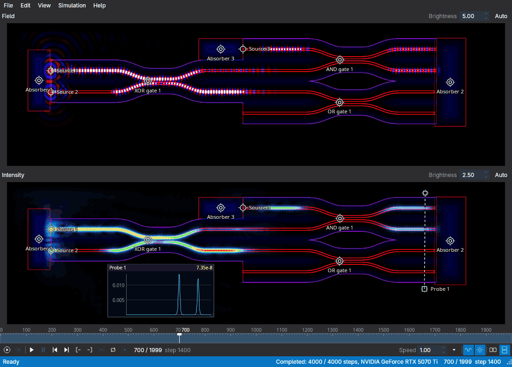

# WaveDude Rust

[](https://github.com/lajosbencz/WaveDudeRust/attestations)

A 2D wave-equation simulator for Linux, macOS and Windows, written in Rust:
- field and intensity views
- scenes from images and optical parts
- point and composite sources
- probes with live graphs and video export.

Try it out:
 - **[Open in browser](https://lajosbencz.github.io/WaveDudeRust/app/)**
 - [Download and install](https://github.com/lajosbencz/WaveDudeRust/releases/latest)



## Highlights

- It opens and saves the project files of [WaveDude Next](https://github.com/graealex/WaveDudeNext) (`.wdproj`).
- Runs on Linux, macOS and Windows; GPU through wgpu (Vulkan, Metal, DX12),
  and a CPU engine with the same features.
- The maths follows the literature, not a reference program: unscaled
  Laplacians, dispersion-relation-preserving stencil weights, sub-steps from
  the CFL bound, a CPML absorber that reflects -74 to -104 dB of an outgoing
  wave; the phase error at 6 cells per wavelength is 0.08 %. Analytic physics
  tests state every tolerance ([`docs/physics.md`](docs/physics.md)).
- Live editing: one worker, one engine and one store converge on what the
  user looks at; an edit replaces the frames without a stale run or a timer.
- 53 example projects grouped by topic, among them the photonic logic gates
  from [Huygens Optics](https://www.youtube.com/@HuygensOptics)' video with
  measured truth tables ([`examples/gates`](examples/gates/)).
- Self-updating releases with build provenance and SBOM attestations.

## Differences from WaveDude Next

The program is meant to be a drop-in for WaveDude Next users: the same
layout, keys, files and behaviour, specified in [`docs/spec`](docs/spec) and
[`docs/ui`](docs/ui) from reading what the original does, never its code.
It differs on purpose where the literature has a better technique (the
solver, the absorber), where the original's behaviour is a quirk of its
implementation (the live preview, undo steps), and where a Windows-only
integration has no cross-platform equivalent. Every such difference is one
row in [`docs/divergences.md`](docs/divergences.md), pointing to the
decision record in [`docs/decisions`](docs/decisions) that holds the
reasoning; what warrants a new one is in
[`CONTRIBUTING.md`](CONTRIBUTING.md).

## Releases

Installers for Windows (NSIS), macOS (universal app and DMG) and Linux
(AppImage, and a tarball with an [`install.sh`](crates/wavedude-app/assets/linux/install.sh) for the menu entry, icons and
file types) are on the GitHub releases
page, unsigned by Apple and Microsoft, so Gatekeeper and SmartScreen warn at
the first start. Releases are immutable once published. Each package carries
build provenance and CycloneDX SBOM attestations made by the release's build
workflow, the SBOMs are attached too, `SHA256SUMS` lists every file, and the
binaries embed their dependency list (`cargo audit bin`). Before a release
goes public its workflow verifies every file against its attestation and
writes the result into the release notes: the file, its digest and the
workflow that made it. Nothing is uploaded by hand. To check a download
yourself:

```sh
gh release verify-asset <tag> <file> --repo lajosbencz/WaveDudeRust   # the file this release published (GitHub's attestation)
gh attestation verify <file> --repo lajosbencz/WaveDudeRust          # built by this repository's workflow at the release's commit
```

Adding `--signer-workflow lajosbencz/WaveDudeRust/.github/workflows/package.yml`
to the second one also checks that the build workflow itself made the
attestation, not any other workflow of the repository.

The installed program updates itself from the releases when the user agrees.
How a release is made: [`docs/release.md`](docs/release.md)
([decision 0011](docs/decisions/0011-releases-and-updates.md)).

## Dependencies

MP4 export uses Cisco's prebuilt OpenH264, which Cisco's H.264 patent licence
covers only when it is downloaded from Cisco to the user's device. Release
builds therefore carry no H.264 encoder: the app's startup page asks whether
to enable it and the app downloads it at the first MP4 export, the CLI on
`wavedude-cli openh264 enable`; both share the choice ([decision 0005](docs/decisions/0005-video-openh264.md)). The `openh264-source`
feature compiles OpenH264 in for development and tests; a build made with it
must not be distributed without an H.264 patent licence. `wavedude-export` and
`wavedude-cli` build without MP4 through `--no-default-features`.

## Documentation and contributing

[`docs/spec`](docs/spec) is what the core must do, [`docs/ui`](docs/ui) what the application must do,
[`docs/decisions`](docs/decisions) why, [`docs/measurements.md`](docs/measurements.md) how fast,
[`docs/conventions.md`](docs/conventions.md) how the code is written.
Issues, pull requests and the acceptance criteria: [`CONTRIBUTING.md`](CONTRIBUTING.md);
vulnerabilities: [`SECURITY.md`](SECURITY.md).

## Lineage

WaveDudeRust reimplements [WaveDude Next](https://github.com/graealex/WaveDudeNext)
by Alexander Graef, itself the successor of Wave Dude 2D by Jeroen Vleggaar
([Huygens Optics](https://www.youtube.com/@HuygensOptics)), whose numerics followed 0x23's
[WaveSimulator2D](https://github.com/0x23/WaveSimulator2D). No code is carried
over; the colour schemes, the example projects, the user interface strings and
the manual's content are ([`NOTICE.md`](NOTICE.md)).

## Copyright and license

Copyright (C) 2026 Lajos Bencz.

WaveDudeRust is a modified work, written in 2026, of WaveDude Next, Copyright
(C) 2026 Alexander Graef, itself based on Wave Dude 2D, Copyright (C) 2026
Jeroen Vleggaar (Huygens Optics). It carries material of WaveDude Next: the
colour schemes, the example projects, the user interface strings and the
manual's content.

WaveDudeRust is free software: you can redistribute it and/or modify it under
the terms of the GNU General Public License as published by the Free Software
Foundation, either version 3 of the License, or (at your option) any later
version. It is distributed WITHOUT ANY WARRANTY; see [`LICENSE.md`](LICENSE.md).
