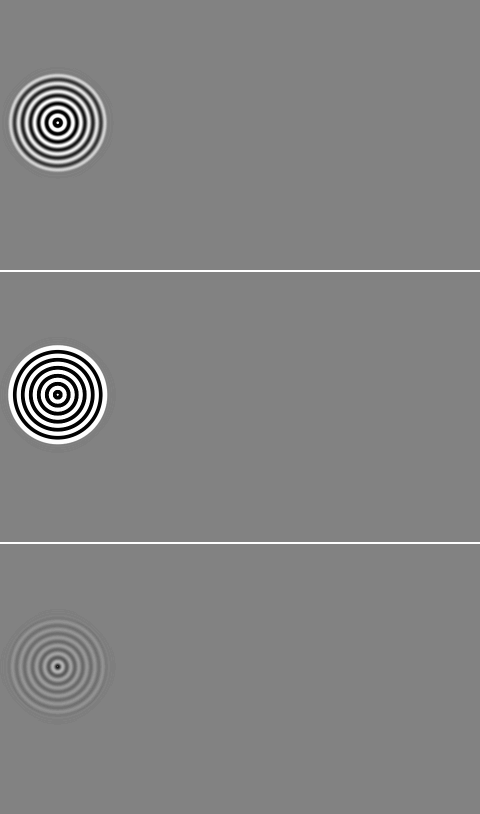
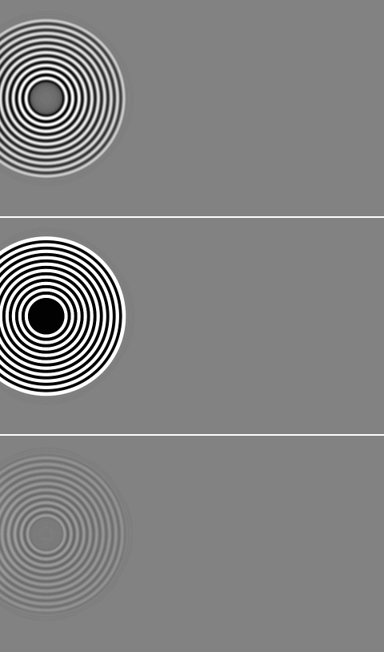
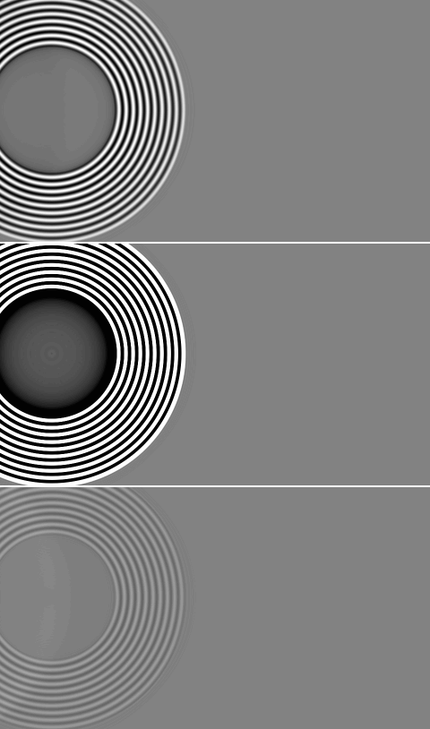
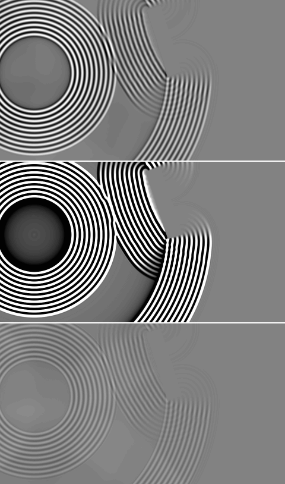

# Example01_Source_Mirror_Probe: C# WaveDudeNext against the Rust engine

Both CPU engines, 600 steps, fields dumped every 100 steps. Generated by `wave-cli compare`.

| | C# | Rust |
|---|---|---|
| canvas | 960x540 | 960x540 |
| rim | 64 | 64 |
| edges | Open | Open |
| stencil | FourthOrder | FourthOrder |
| sub-steps | 3 | 2 |
| emitters | 1 | 1 |

## Painted scene

0 of 518400 pixels differ (0.000 %); 0 of them (0.0 %) lie within 2 px of an index edge of the C# scene.

| channel | pixels differing | max difference | mean difference where differing |
|---|---|---|---|
| red (index) | 0 | 0 | 0.00 |
| green (sources) | 0 | 0 | 0.00 |
| blue (absorption) | 0 | 0 | 0.00 |
| alpha | 0 | 0 | 0.00 |

Red differences by size: 1 level 0, 2-5 levels 0, 6-20 levels 0, over 20 levels 0.

C#:  Rust:  Difference x8: 

## Field

Pearson and RMS difference over the canvas; PSNR against the C# field's peak |u|; energy the ratio of the sums of u squared; front the farthest pixel right of a source on its row above 1 % of that stretch's peak |u| ("edge" once it has left the canvas). Gain: the least-squares g of Rust ~ g C#; the RMS difference after gain compares Rust / g with C#, the shape alone. Pictures: C# | Rust | Rust / g - C#, grey at the C# field's 99.5th percentile of |u|.

### Field, Rust as loaded

| step | Pearson | RMS diff / RMS C# | PSNR dB | gain | RMS diff after gain | energy Rust / C# | intensity Pearson |
|---|---|---|---|---|---|---|---|
| 100 | 0.980 | 6.914 | 11.0 | 7.735 | 0.202 | 62.267 | 0.967 |
| 200 | 0.978 | 6.918 | -3.8 | 7.718 | 0.214 | 62.293 | 0.999 |
| 300 | 0.972 | 6.916 | -6.7 | 7.666 | 0.241 | 62.167 | 1.000 |
| 400 | 0.975 | 6.895 | 12.0 | 7.663 | 0.231 | 61.867 | 0.959 |
| 500 | 0.975 | 6.945 | -2.7 | 7.713 | 0.231 | 62.663 | 0.994 |
| 600 | 0.969 | 6.875 | -6.2 | 7.592 | 0.257 | 61.453 | 0.999 |

Wave front and wavelength right of each source along its row (meaningful where one source owns the row):

| step | Source 1 (115, 245): front C# / Rust | wavelength C# / Rust |
|---|---|---|
| 100 | 99 / 98 | 16.1 / 16.1 |
| 200 | 202 / 199 | 16.0 / 16.1 |
| 300 | 303 / 301 | 16.0 / 16.0 |
| 400 | 399 / 398 | 28.4 / 28.4 |
| 500 | 445 / 445 | 26.8 / 26.8 |
| 600 | 598 / 597 | 15.5 / 19.4 |

Step 100: 

Step 200: 

Step 300: 

Step 400: 

Step 500: 

Step 600: 

## Probes

Each probe's mean over its cells in its layer, every step; statistics over steps 301 to 600 (after the transient). Amplitude ratio: RMS of the Rust series over the C# one (mean, for an intensity).

| probe | Rust run | Pearson | amplitude ratio | C# RMS | Rust RMS |
|---|---|---|---|---|---|
| Probe 1 | as loaded | 1.000 | 62.070 | 8.850e-6 | 5.493e-4 |

