# Example09_Laplacian_dispersion: C# WaveDudeNext against the Rust engine

Both CPU engines, 600 steps, fields dumped every 100 steps. Generated by `wavedude-cli compare`.

| | C# | Rust |
|---|---|---|
| canvas | 1600x800 | 1600x800 |
| rim | 32 | 32 |
| edges | Open | Open |
| stencil | NinePoint | NinePoint |
| sub-steps | 1 | 2 |
| emitters | 4 | 4 |

## Painted scene

0 of 1280000 pixels differ (0.000 %); 0 of them (0.0 %) lie within 2 px of an index edge of the C# scene.

| channel | pixels differing | max difference | mean difference where differing |
|---|---|---|---|
| red (index) | 0 | 0 | 0.00 |
| green (sources) | 0 | 0 | 0.00 |
| blue (absorption) | 0 | 0 | 0.00 |
| alpha | 0 | 0 | 0.00 |

Red differences by size: 1 level 0, 2-5 levels 0, 6-20 levels 0, over 20 levels 0.

C#:  Rust:  Difference x8: 

## Field

Pearson and RMS difference over the canvas; PSNR against the C# field's peak |u|; energy the ratio of the sums of u squared; front the farthest pixel right of a source on its row above 1 % of that stretch's peak |u| ("edge" once it has left the canvas). Gain: the least-squares g of Rust ~ g C#; the RMS difference after gain compares Rust / g with C#, the shape alone. Pictures: C# | Rust | Rust / g - C#, grey at the C# field's 99.5th percentile of |u|.

### Field, Rust as loaded (the frequency scale divided by the original 9-point kernel's phase speed 0.5621, so the wavelengths match the original's)

| step | Pearson | RMS diff / RMS C# | PSNR dB | gain | RMS diff after gain | energy Rust / C# | intensity Pearson |
|---|---|---|---|---|---|---|---|
| 100 | -0.206 | 8.148 | 18.2 | -1.613 | 4.784 | 62.163 | 0.853 |
| 200 | -0.065 | 6.949 | 16.7 | -0.445 | 15.286 | 46.393 | 0.866 |
| 300 | -0.142 | 6.897 | 15.6 | -0.947 | 6.986 | 44.680 | 0.871 |
| 400 | -0.318 | 6.998 | 14.3 | -2.101 | 2.985 | 43.767 | 0.875 |
| 500 | 0.114 | 6.538 | 13.8 | 0.747 | 8.744 | 43.235 | 0.875 |
| 600 | 0.209 | 6.452 | 13.7 | 1.375 | 4.684 | 43.385 | 0.873 |

Wave front and wavelength right of each source along its row (meaningful where one source owns the row):

| step | Source frequency = 30 (105, 116): front C# / Rust | wavelength C# / Rust | Source frequency = 60 (105, 302): front C# / Rust | wavelength C# / Rust | Source frequency = 120 (107, 492): front C# / Rust | wavelength C# / Rust | Source frequency = 240 (108, 686): front C# / Rust | wavelength C# / Rust |
|---|---|---|---|---|---|---|---|---|
| 100 | 56 / 98 | - / 29.5 | 57 / 100 | 15.0 / 15.0 | 57 / 99 | 7.3 / 7.3 | 57 / 99 | 3.5 / 3.5 |
| 200 | 112 / 199 | 29.4 / 29.9 | 113 / 199 | 15.0 / 15.0 | 113 / 201 | 7.3 / 7.4 | 112 / 143 | 3.5 / 3.3 |
| 300 | 170 / 299 | 29.9 / 29.8 | 170 / 300 | 14.9 / 14.9 | 170 / 298 | 7.4 / 7.4 | 168 / 199 | 3.6 / 3.3 |
| 400 | 225 / 397 | 29.7 / 29.9 | 226 / 400 | 14.9 / 14.9 | 225 / 397 | 7.4 / 7.4 | 224 / 396 | 3.6 / 3.8 |
| 500 | 280 / 498 | 29.8 / 34.3 | 282 / 497 | 14.9 / 14.9 | 281 / 500 | 7.4 / 7.4 | 280 / 345 | 3.7 / 3.3 |
| 600 | 337 / 598 | 29.9 / 31.6 | 338 / 598 | 14.9 / 14.9 | 337 / 595 | 7.4 / 7.5 | 335 / 384 | 3.7 / 3.3 |

Step 100: 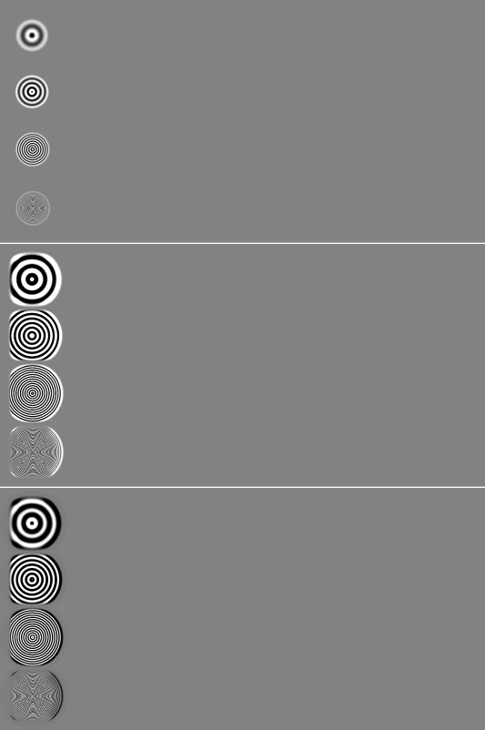

Step 200: 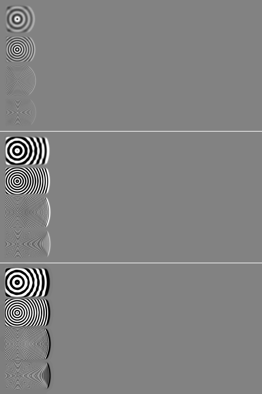

Step 300: 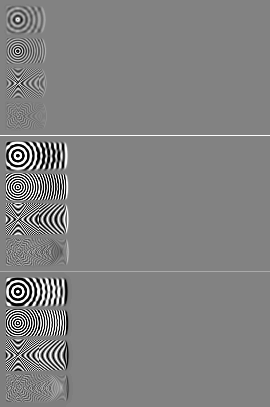

Step 400: 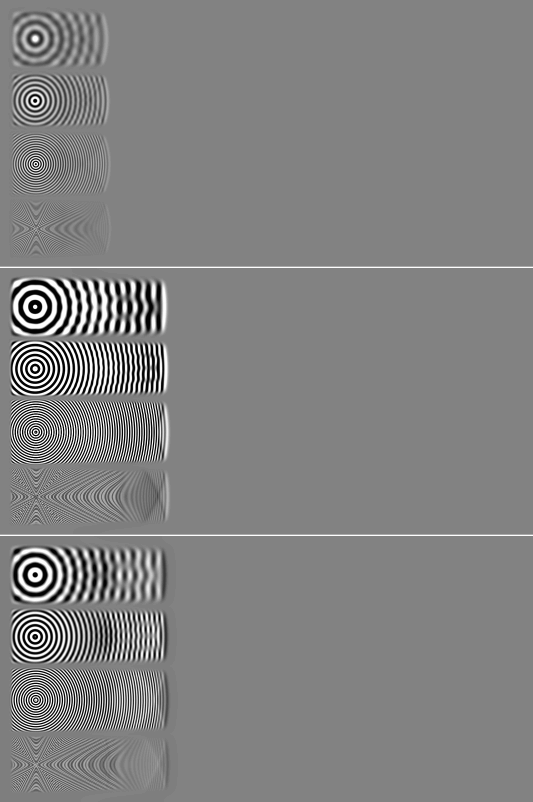

Step 500: 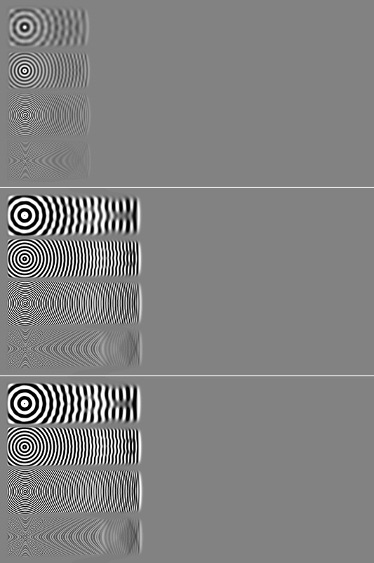

Step 600: 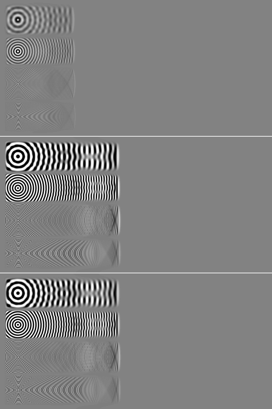

### Field, Rust unscaled (the original's frequency scale, so the waves are 1/0.562 longer)

| step | Pearson | RMS diff / RMS C# | PSNR dB | gain | RMS diff after gain | energy Rust / C# | intensity Pearson |
|---|---|---|---|---|---|---|---|
| 100 | 0.002 | 9.419 | 17.0 | 0.034 | 276.967 | 87.785 | 0.874 |
| 200 | 0.010 | 7.931 | 15.6 | 0.077 | 102.003 | 62.048 | 0.892 |
| 300 | 0.001 | 7.755 | 14.6 | 0.009 | 878.337 | 59.152 | 0.899 |
| 400 | 0.015 | 7.756 | 13.4 | 0.112 | 68.619 | 59.384 | 0.900 |
| 500 | 0.012 | 7.722 | 12.3 | 0.089 | 86.608 | 58.810 | 0.901 |
| 600 | 0.006 | 7.724 | 12.2 | 0.048 | 160.042 | 58.761 | 0.900 |

Wave front and wavelength right of each source along its row (meaningful where one source owns the row):

| step | Source frequency = 30 (105, 116): front C# / Rust | wavelength C# / Rust | Source frequency = 60 (105, 302): front C# / Rust | wavelength C# / Rust | Source frequency = 120 (107, 492): front C# / Rust | wavelength C# / Rust | Source frequency = 240 (108, 686): front C# / Rust | wavelength C# / Rust |
|---|---|---|---|---|---|---|---|---|
| 100 | 56 / 97 | - / 51.6 | 57 / 98 | 15.0 / 26.1 | 57 / 100 | 7.3 / 13.3 | 57 / 100 | 3.5 / 6.4 |
| 200 | 112 / 196 | 29.4 / 53.2 | 113 / 199 | 15.0 / 26.4 | 113 / 200 | 7.3 / 13.3 | 112 / 199 | 3.5 / 6.5 |
| 300 | 170 / 298 | 29.9 / 68.0 | 170 / 298 | 14.9 / 26.6 | 170 / 299 | 7.4 / 13.3 | 168 / 297 | 3.6 / 6.5 |
| 400 | 225 / 398 | 29.7 / 62.9 | 226 / 399 | 14.9 / 28.7 | 225 / 399 | 7.4 / 13.3 | 224 / 396 | 3.6 / 6.5 |
| 500 | 280 / 495 | 29.8 / 53.6 | 282 / 497 | 14.9 / 28.2 | 281 / 498 | 7.4 / 13.3 | 280 / 469 | 3.7 / 6.5 |
| 600 | 337 / 595 | 29.9 / 53.7 | 338 / 598 | 14.9 / 28.0 | 337 / 598 | 7.4 / 13.2 | 335 / 576 | 3.7 / 6.5 |

Step 100: 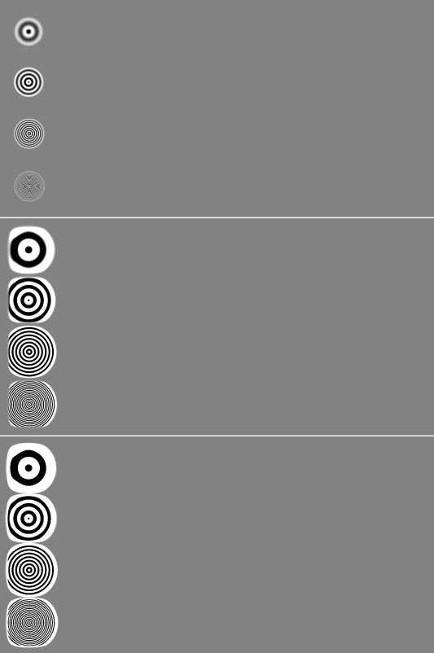

Step 200: 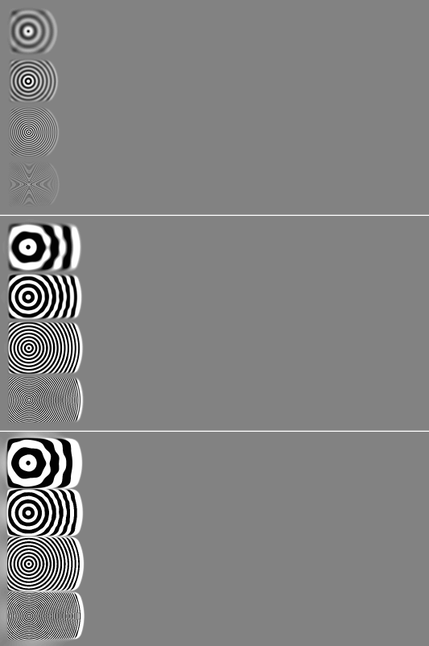

Step 300: 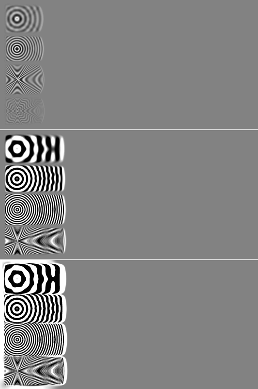

Step 400: 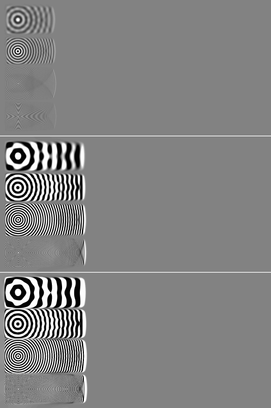

Step 500: 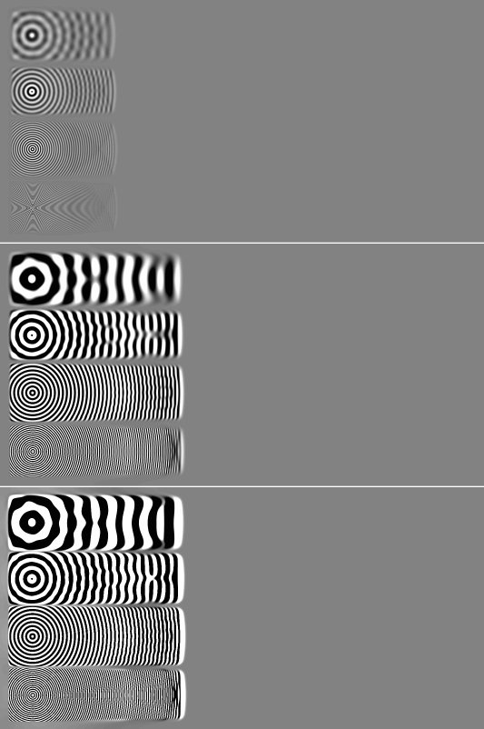

Step 600: 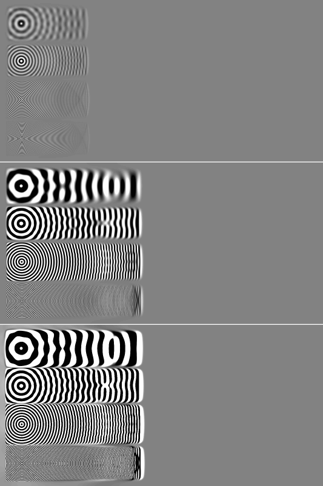

