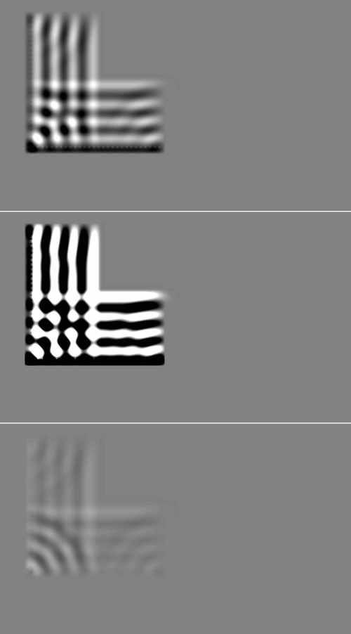
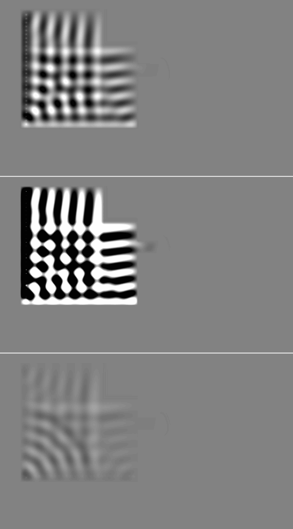
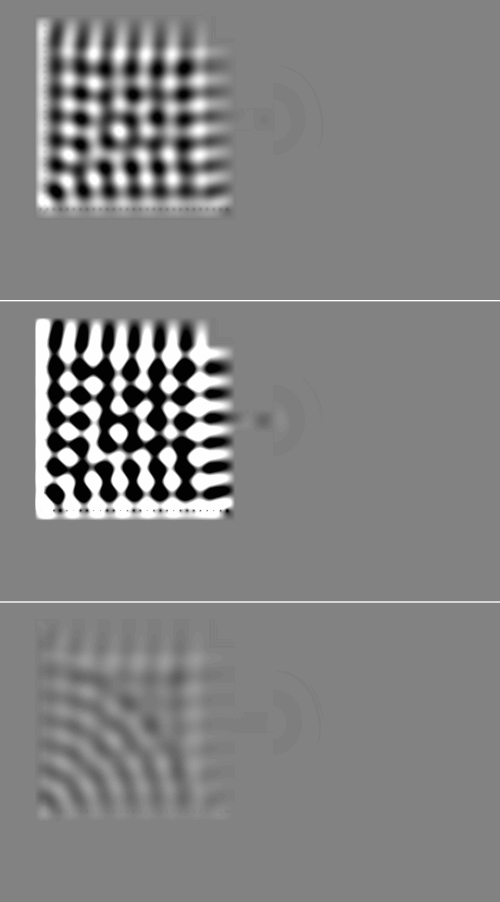
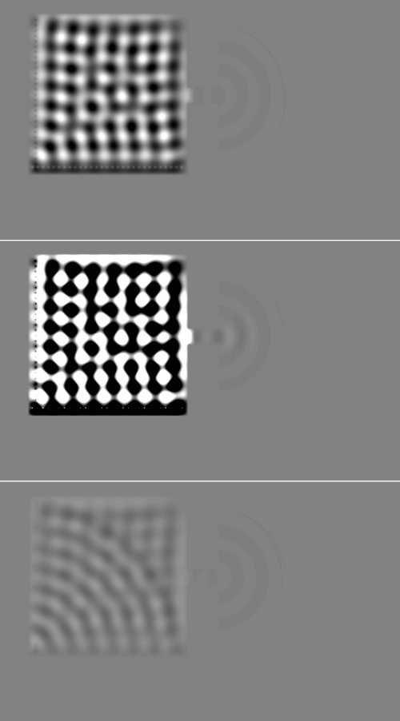

# Example16_Wave_in_2_boxes: C# WaveDudeNext against the Rust engine

Both CPU engines, 600 steps, fields dumped every 100 steps. Generated by `wavedude-cli compare`.

| | C# | Rust |
|---|---|---|
| canvas | 1500x900 | 1500x900 |
| rim | 0 | 0 |
| edges | Open | Open |
| stencil | FourthOrder | FourthOrder |
| sub-steps | 3 | 2 |
| emitters | 58 | 58 |

## Painted scene

0 of 1350000 pixels differ (0.000 %); 0 of them (0.0 %) lie within 2 px of an index edge of the C# scene.

| channel | pixels differing | max difference | mean difference where differing |
|---|---|---|---|
| red (index) | 0 | 0 | 0.00 |
| green (sources) | 0 | 0 | 0.00 |
| blue (absorption) | 0 | 0 | 0.00 |
| alpha | 0 | 0 | 0.00 |

Red differences by size: 1 level 0, 2-5 levels 0, 6-20 levels 0, over 20 levels 0.

C#:  Rust:  Difference x8: 

## Field

Pearson and RMS difference over the canvas; PSNR against the C# field's peak |u|; energy the ratio of the sums of u squared; front the farthest pixel right of a source on its row above 1 % of that stretch's peak |u| ("edge" once it has left the canvas). Gain: the least-squares g of Rust ~ g C#; the RMS difference after gain compares Rust / g with C#, the shape alone. Pictures: C# | Rust | Rust / g - C#, grey at the C# field's 99.5th percentile of |u|.

### Field, Rust as loaded

| step | Pearson | RMS diff / RMS C# | PSNR dB | gain | RMS diff after gain | energy Rust / C# | intensity Pearson |
|---|---|---|---|---|---|---|---|
| 100 | 0.970 | 4.678 | 8.8 | 5.469 | 0.253 | 31.823 | 0.992 |
| 200 | 0.981 | 4.087 | 6.9 | 4.967 | 0.198 | 25.636 | 0.985 |
| 300 | 0.979 | 3.982 | 6.0 | 4.851 | 0.209 | 24.560 | 0.984 |
| 400 | 0.980 | 3.975 | 4.7 | 4.853 | 0.202 | 24.508 | 0.985 |
| 500 | 0.981 | 3.940 | 3.6 | 4.824 | 0.197 | 24.173 | 0.987 |
| 600 | 0.982 | 3.929 | 3.0 | 4.818 | 0.192 | 24.076 | 0.989 |

Wave front and wavelength right of each source along its row (meaningful where one source owns the row):

| step | Vertical source (134, 355): front C# / Rust | wavelength C# / Rust | Horizontal source (401, 627): front C# / Rust | wavelength C# / Rust |
|---|---|---|---|---|
| 100 | 97 / 97 | - / - | 303 / 302 | 19.9 / 19.4 |
| 200 | 197 / 197 | 80.4 / 78.5 | 303 / 303 | - / 19.4 |
| 300 | 593 / 593 | 69.1 / 58.1 | 303 / 303 | - / 133.5 |
| 400 | 659 / 659 | 105.9 / 105.5 | 303 / 303 | - / - |
| 500 | 722 / 721 | 151.2 / 110.3 | 303 / 300 | 15.8 / 19.7 |
| 600 | 782 / 783 | 88.2 / 87.9 | 303 / 303 | 33.9 / 25.4 |

Step 100: 

Step 200: 

Step 300: 

Step 400: 

Step 500: 

Step 600: 

## Probes

Each probe's mean over its cells in its layer, every step; statistics over steps 301 to 600 (after the transient). Amplitude ratio: RMS of the Rust series over the C# one (mean, for an intensity).

| probe | Rust run | Pearson | amplitude ratio | C# RMS | Rust RMS |
|---|---|---|---|---|---|
| Log intensity distribution over boxes | as loaded | 0.976 | 25.061 | 1.140e-3 | 2.857e-2 |
| Field amplitude diagonal left box | as loaded | 0.961 | 5.917 | 4.297e-3 | 2.543e-2 |

