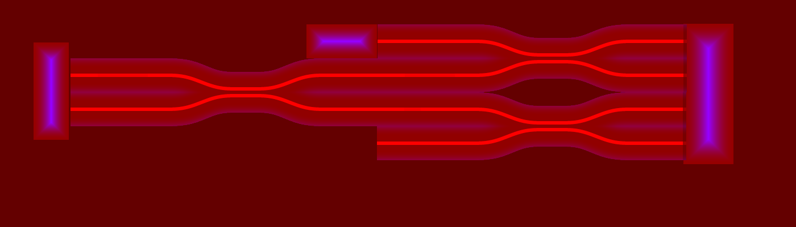
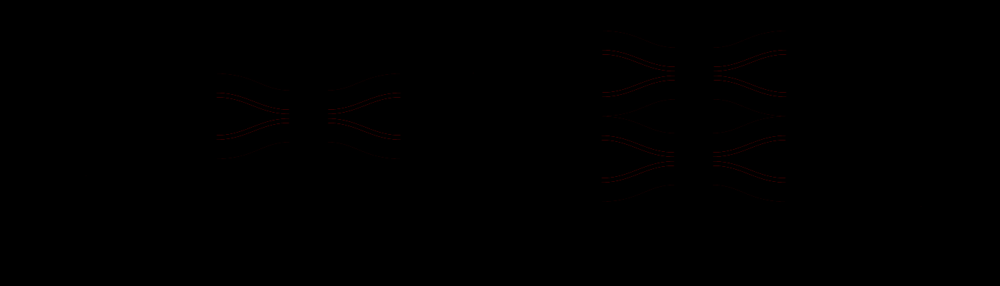
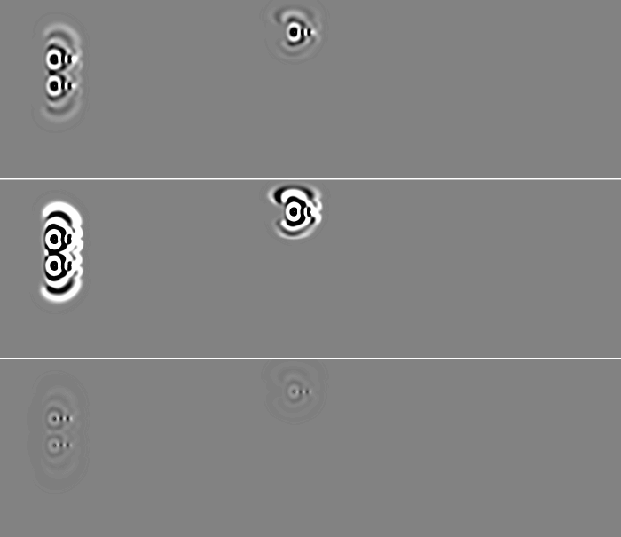
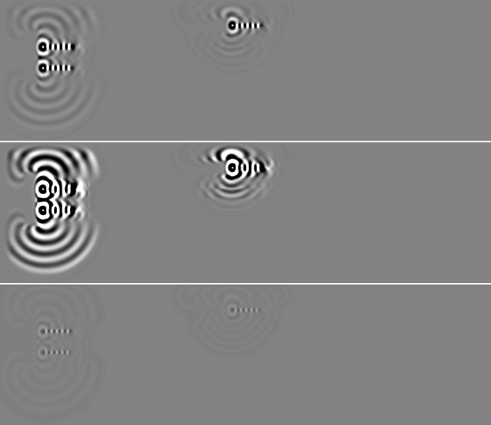
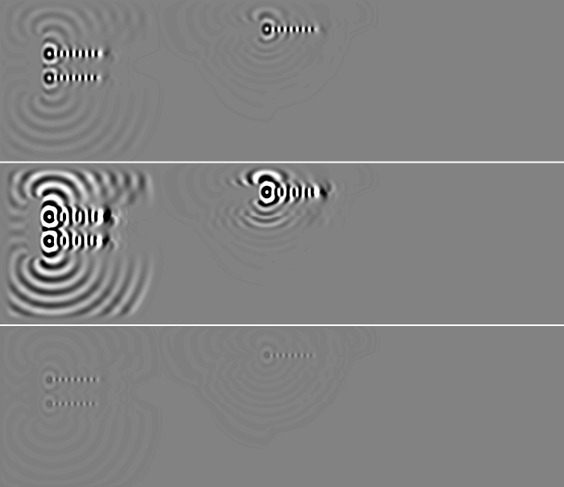
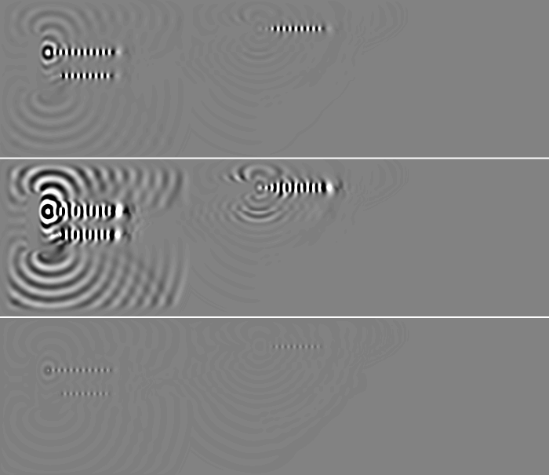
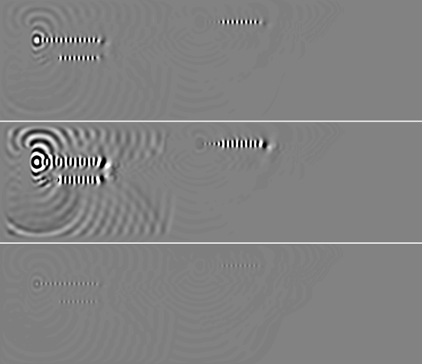
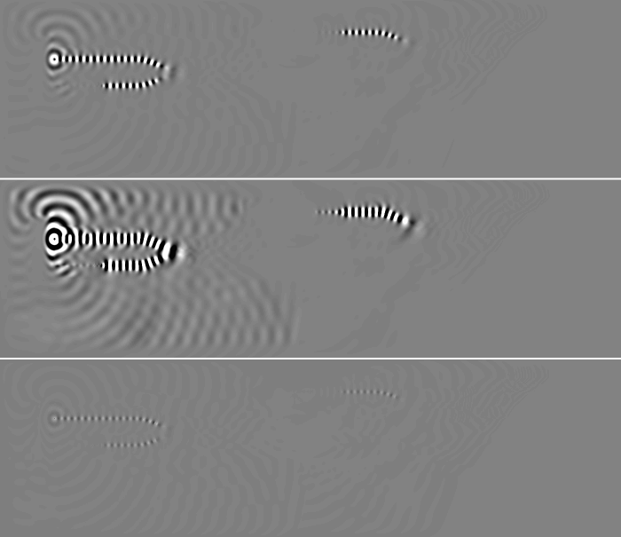

# Example18_XOR_AND_OR_logic: C# WaveDudeNext against the Rust engine

Both CPU engines, 600 steps, fields dumped every 100 steps. Generated by `wave-cli compare`.

| | C# | Rust |
|---|---|---|
| canvas | 1400x401 | 1400x401 |
| rim | 0 | 0 |
| edges | Open | Open |
| stencil | FourthOrder | FourthOrder |
| sub-steps | 3 | 2 |
| emitters | 3 | 3 |

## Painted scene

3435 of 561400 pixels differ (0.612 %); 3435 of them (100.0 %) lie within 2 px of an index edge of the C# scene.

| channel | pixels differing | max difference | mean difference where differing |
|---|---|---|---|
| red (index) | 3435 | 8 | 4.15 |
| green (sources) | 0 | 0 | 0.00 |
| blue (absorption) | 0 | 0 | 0.00 |
| alpha | 0 | 0 | 0.00 |

Red differences by size: 1 level 456, 2-5 levels 1923, 6-20 levels 1056, over 20 levels 0.

C#:  Rust:  Difference x8: 

## Field

Pearson and RMS difference over the canvas; PSNR against the C# field's peak |u|; energy the ratio of the sums of u squared; front the farthest pixel right of a source on its row above 1 % of that stretch's peak |u| ("edge" once it has left the canvas). Gain: the least-squares g of Rust ~ g C#; the RMS difference after gain compares Rust / g with C#, the shape alone. Pictures: C# | Rust | Rust / g - C#, grey at the C# field's 99.5th percentile of |u|.

### Field, Rust as loaded

| step | Pearson | RMS diff / RMS C# | PSNR dB | gain | RMS diff after gain | energy Rust / C# | intensity Pearson |
|---|---|---|---|---|---|---|---|
| 100 | 0.992 | 5.471 | 17.6 | 6.412 | 0.125 | 41.760 | 0.977 |
| 200 | 0.991 | 5.490 | 15.0 | 6.424 | 0.133 | 41.990 | 0.989 |
| 300 | 0.992 | 5.475 | 15.0 | 6.417 | 0.125 | 41.813 | 0.993 |
| 400 | 0.994 | 5.452 | 13.3 | 6.404 | 0.114 | 41.537 | 0.996 |
| 500 | 0.994 | 5.460 | 12.8 | 6.411 | 0.114 | 41.638 | 0.997 |
| 600 | 0.992 | 5.464 | 12.5 | 6.402 | 0.128 | 41.659 | 0.998 |

Wave front and wavelength right of each source along its row (meaningful where one source owns the row):

| step | Source 1 (123, 133): front C# / Rust | wavelength C# / Rust | Source 2 (123, 193): front C# / Rust | wavelength C# / Rust | Source 3 (663, 72): front C# / Rust | wavelength C# / Rust |
|---|---|---|---|---|---|---|
| 100 | 58 / 58 | 15.3 / 15.3 | 58 / 57 | 15.2 / 15.2 | 57 / 57 | 15.3 / 15.4 |
| 200 | 536 / 116 | 15.9 / 17.2 | 115 / 113 | 17.0 / 17.0 | 114 / 111 | 17.2 / 17.1 |
| 300 | 546 / 168 | 23.8 / 18.1 | 167 / 162 | 17.8 / 16.0 | 151 / 149 | 16.0 / 16.1 |
| 400 | 207 / 207 | 16.9 / 16.9 | 218 / 218 | 17.0 / 17.0 | 211 / 210 | 16.8 / 16.8 |
| 500 | 248 / 248 | 16.7 / 16.6 | 261 / 260 | 16.0 / 18.9 | 250 / 249 | 16.6 / 16.6 |
| 600 | 261 / 251 | 15.6 / 15.6 | 280 / 279 | 16.3 / 17.4 | 252 / 253 | 14.9 / 15.4 |

Step 100: 

Step 200: 

Step 300: 

Step 400: 

Step 500: 

Step 600: 

## Probes

Each probe's mean over its cells in its layer, every step; statistics over steps 301 to 600 (after the transient). Amplitude ratio: RMS of the Rust series over the C# one (mean, for an intensity).

| probe | Rust run | Pearson | amplitude ratio | C# RMS | Rust RMS |
|---|---|---|---|---|---|
| Probe 1 | as loaded | 0.999 | 27.229 | 2.093e-17 | 5.700e-16 |

