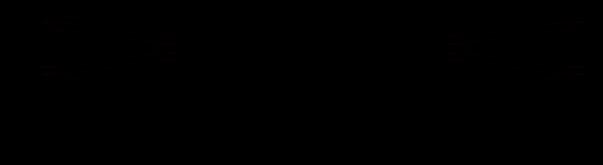
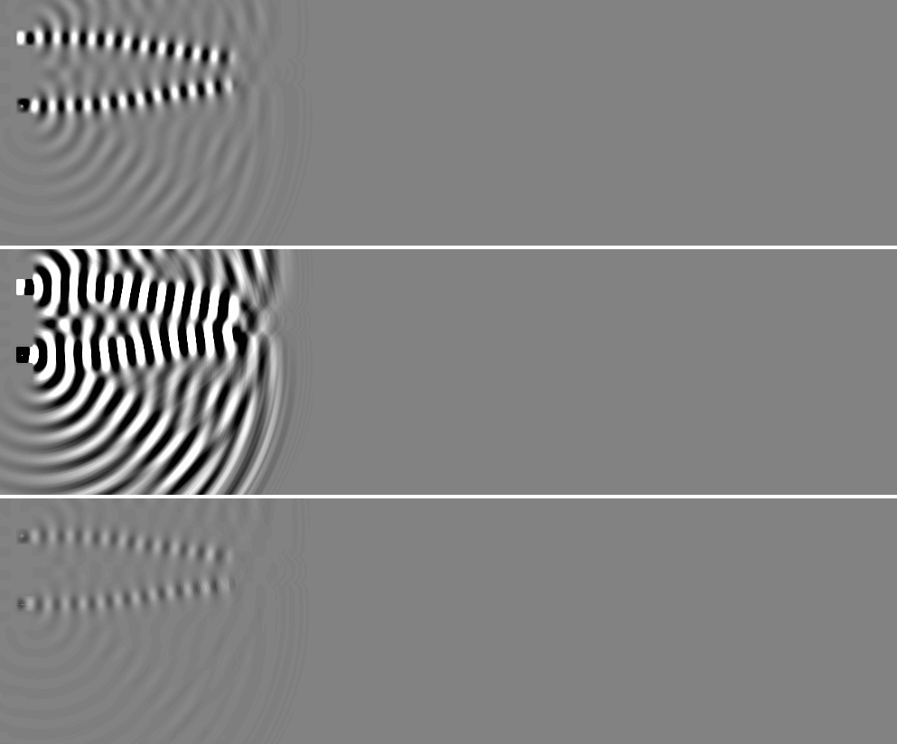
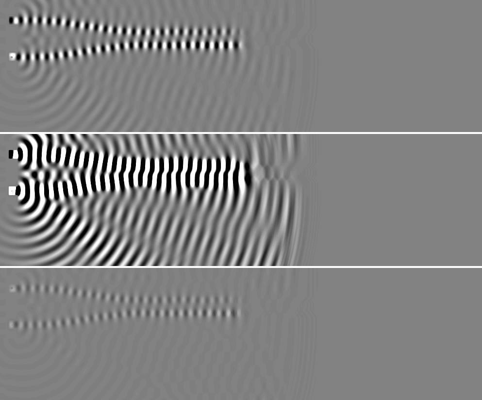
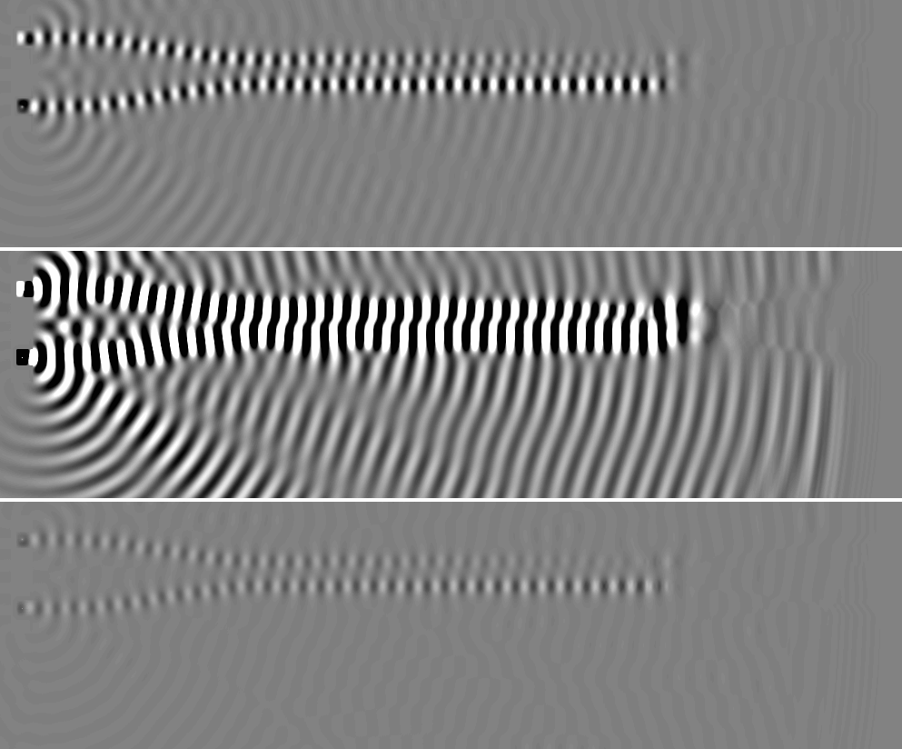
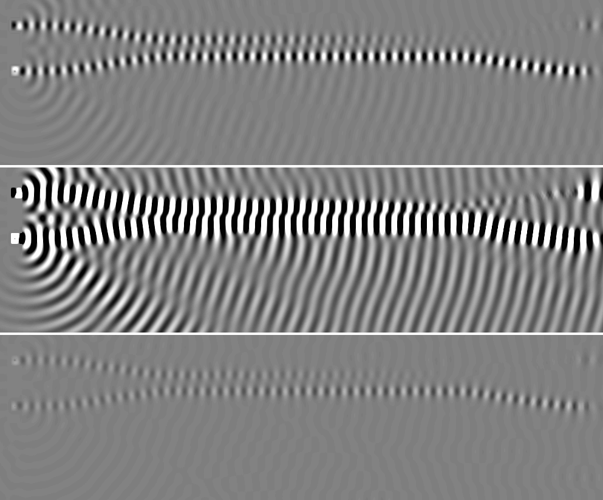
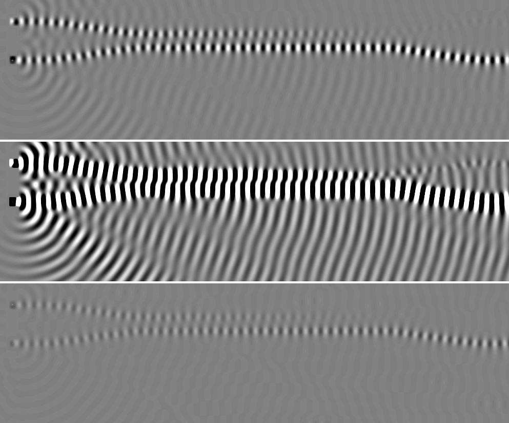
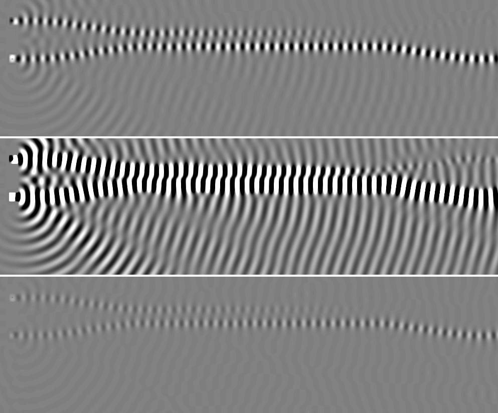

# 07-xor: C# WaveDudeNext against the Rust engine

Both CPU engines, 2592 steps, fields dumped every 432 steps. Generated by `wavedude-cli compare`.

| | C# | Rust |
|---|---|---|
| canvas | 993x272 | 993x272 |
| rim | 32 | 32 |
| edges | Open | Open |
| stencil | FourthOrder | FourthOrder |
| sub-steps | 2 | 1 |
| emitters | 2 | 2 |

## Painted scene

1542 of 270096 pixels differ (0.571 %); 1542 of them (100.0 %) lie within 2 px of an index edge of the C# scene.

| channel | pixels differing | max difference | mean difference where differing |
|---|---|---|---|
| red (index) | 1542 | 5 | 2.07 |
| green (sources) | 0 | 0 | 0.00 |
| blue (absorption) | 0 | 0 | 0.00 |
| alpha | 0 | 0 | 0.00 |

Red differences by size: 1 level 578, 2-5 levels 964, 6-20 levels 0, over 20 levels 0.

C#:  Rust:  Difference x8: 

## Field

Pearson and RMS difference over the canvas; PSNR against the C# field's peak |u|; energy the ratio of the sums of u squared; front the farthest pixel right of a source on its row above 1 % of that stretch's peak |u| ("edge" once it has left the canvas). Gain: the least-squares g of Rust ~ g C#; the RMS difference after gain compares Rust / g with C#, the shape alone. Pictures: C# | Rust | Rust / g - C#, grey at the C# field's 99.5th percentile of |u|.

### Field, Rust as loaded

| step | Pearson | RMS diff / RMS C# | PSNR dB | gain | RMS diff after gain | energy Rust / C# | intensity Pearson |
|---|---|---|---|---|---|---|---|
| 432 | 0.965 | 9.071 | 2.9 | 9.677 | 0.273 | 100.641 | 0.999 |
| 864 | 0.959 | 9.022 | 0.1 | 9.565 | 0.297 | 99.525 | 0.999 |
| 1296 | 0.954 | 9.005 | -1.2 | 9.495 | 0.315 | 99.081 | 0.999 |
| 1728 | 0.948 | 9.001 | -2.3 | 9.431 | 0.334 | 98.874 | 0.999 |
| 2160 | 0.948 | 8.977 | -2.6 | 9.403 | 0.336 | 98.399 | 0.999 |
| 2592 | 0.948 | 8.973 | -2.5 | 9.400 | 0.336 | 98.322 | 0.999 |

Wave front and wavelength right of each source along its row (meaningful where one source owns the row):

| step | A (24, 41): front C# / Rust | wavelength C# / Rust | B (24, 117): front C# / Rust | wavelength C# / Rust |
|---|---|---|---|---|
| 432 | 280 / 291 | 18.2 / 21.0 | 286 / 286 | 20.4 / 20.4 |
| 864 | 582 / 587 | 21.8 / 20.9 | 583 / 588 | 21.8 / 21.8 |
| 1296 | 869 / 826 | 22.9 / 22.1 | 858 / 845 | 21.6 / 21.6 |
| 1728 | edge / edge | 22.1 / 21.1 | edge / edge | 20.8 / 20.8 |
| 2160 | edge / edge | 21.9 / 21.4 | edge / edge | 20.7 / 20.7 |
| 2592 | edge / edge | 21.9 / 21.4 | edge / edge | 20.7 / 20.7 |

Step 432: 

Step 864: 

Step 1296: 

Step 1728: 

Step 2160: 

Step 2592: 

## Probes

Each probe's mean over its cells in its layer, every step; statistics over steps 1297 to 2592 (after the transient). Amplitude ratio: RMS of the Rust series over the C# one (mean, for an intensity).

| probe | Rust run | Pearson | amplitude ratio | C# RMS | Rust RMS |
|---|---|---|---|---|---|
| Input | as loaded | 0.870 | 98.217 | 2.429e-3 | 2.386e-1 |
| Output | as loaded | 0.998 | 99.570 | 1.713e-3 | 1.706e-1 |

