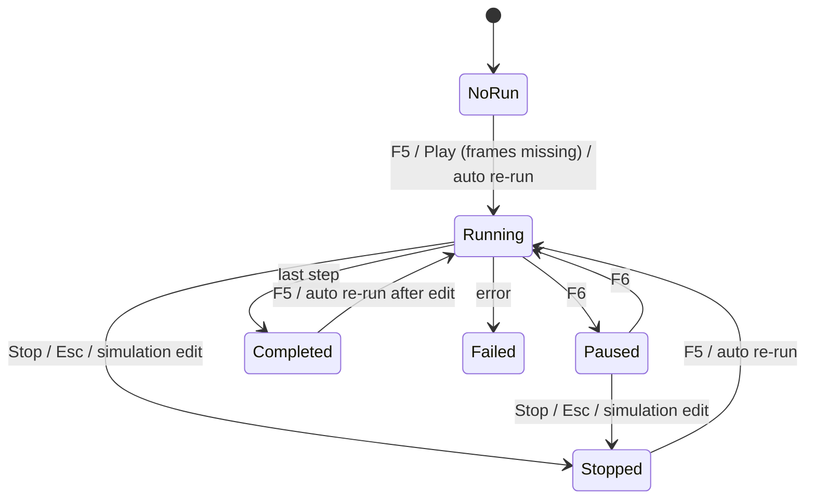

# Timeline and transport bar

Pointers: `Controls/TimelineBar.cs`, `Panes/PreviewPane.xaml(.cs)` (transport, playback clock),
`MainWindow.Simulation.cs`, `MainWindow.Live.cs`, `Commands/PreviewCommands.cs`,
`Commands/SimulationCommands.cs`, figure `Assets/timeline.svg`.

Units: the timeline is in frames. Frame k = state after step k x VisualizeEvery. Frames planned =
ceil(Steps / VisualizeEvery). The in/out points are stored as steps (Display > From step / To step) and shown in
frames. A reduced preview (View > Preview frames) never changes the timeline: a stored frame stands in for the
ones left out.

## Timeline (full width, above the transport bar)

Custom-drawn scrub bar:
- 36 px high, 4,2 margin: a 14 px label row on top, the 22 px bar below. Labels every 1, 2, 5, 10, 20, 50, 100,
  ... frames, the smallest interval at least 64 px wide, left-aligned 2 px after their tick (the last kept inside
  the bar); major ticks 6 px, minor ticks 3 px every fifth of the interval.
- Playhead: a line through the bar, a 10 x 6 triangle on top and the frame number 8 px beside it over a patch of
  the bar's colour (it hides the tick labels under it).
- In/out range: a translucent accent band between two brackets (2 px bar + 6 px feet pointing into the range)
  once the range is narrower than the run.
- Frames made: shaded bands over the frames the live run holds (accent); they grow from the position outward
  after an edit, from frame 0 after Run. The playhead is bounded by the band it is in for a run the user started
  and follows.
- Hover: a line and the frame number under the pointer.
- Frame 0 on the first pixel column inside the outline, the last frame on the last; lines whole device pixels.
- Tooltip: "Click or drag to scrub; drag a bracket to move the start or end of the export range. Left/Right step
  a frame, PageUp/PageDown ten, Home/End jump to the start/end of the range".

Input:

| Input | Effect |
|---|---|
| Click / drag on the bar | Jump / scrub to the nearest frame. Turns Live off and pauses playback (decision 0008). |
| Drag a bracket (hit area +/- a few px; nearer wins) | Moves the in or out point. |
| Left / Right | One frame. |
| PageUp / PageDown | Ten frames (PageUp forward). |
| Home / End | In point / out point (start / end when unset). |
| Wheel | One frame. |
| Space | Play / pause. |

Exposed to automation as a slider with range value, plus "range <in>..<out>".

## Transport bar (tab order = index)

| # | Control | Tooltip / key | Behaviour |
|---|---|---|---|
| 0 | Run / Stop button (ring + triangle; ring + square while a run is active) | "Run the simulation from the start (F5)" / "Stop the simulation; the frames so far stay (Esc)" | Run starts a full run from step 0 and follows it; while active the same button stops. |
| 1 | Pause run (ring + two bars) | "Pause the simulation (F6)" / "Resume the simulation (F6)" | Toggles the run's pause. Disabled without an active run. |
| - | divider | | |
| 2 | Play | "Play (Space)" | Disabled while playing. |
| 3 | Pause | "Pause (Space)" | Disabled while not playing. Executing Play/Pause by keyboard moves focus to the other button. |
| 4 | Previous frame | "Previous frame (,)" | |
| 5 | Next frame | "Next frame (.)" | |
| 6 | Set in point | "Start the export range at this frame (I)" | An in point past the out point clears the out point. |
| 7 | Set out point | "End the export range at this frame (O)" | The last frame is stored as 0 (= end). An out point before the in point clears the in point. |
| 8 | Clear range | "Clear the export range: the whole run is exported (X)" | Disabled when no range is set. |
| 9 | Loop (toggle) | "Loop playback over the export range (L)" | |
| 10 | Live (toggle, dot in ring) | "Follow the newest frame while the run is in progress (F)" | Disabled (greyed) without an active run. |
| - | Readout | "Frame shown / last frame" | "frame / last"; then, dimmer, "step N" (tooltip "Simulation step of the frame shown"). Shows both frame and step (do not change). |
| 11 | Speed: label "Speed" + editable combo (64 px) | "Playback speed: pick a factor or type one" | Presets 0.25, 0.5, 1, 1.5, 2, 4 (current culture's decimal separator); any typed value 0.01..100. Space inside is swallowed. |
| 12 | Show field (toggle, wave icon) | "Show the field picture" | = Display > Field > Preview. |
| 13 | Show intensity (toggle, sun icon) | "Show the intensity picture" | = Display > Intensity > Preview. |
| 14 | Layout radios: side by side / stacked | "Field and intensity side by side" / "Field above intensity" | One tab stop on the checked radio; Left/Right check the other. |

Right-docked items (speed, toggles, radios) sit at the right end. Then the timeline, picture brightness boxes and
the splitter follow in the pane's Tab order (harness order: play > step back/forward > in > out > loop > speed >
show field/intensity > split > timeline > field brightness > splitter > intensity brightness).

Bar: 1 px top border, padding 4,3; buttons 22 x 22 with 1 px side margins; dividers 1 px with 4,2 margins after
Pause run, Pause, Next frame and Live and before the picture toggles. Readout with 4 px margins, the step in grey;
"Speed" with margins 8,0,4,0. Toggle buttons stay pressed while checked; the disabled look is grey; keyboard focus =
accent border.

## Playback

- Speed 1 = the project's video frame rate (Display > Frame rate) in frames per second of wall-clock time,
  measured with a clock so a slow tick does not slow playback (harness: ~120 frames in 2 s at speed 1, ~480 at
  speed 4, on its test project).
- Ticks about 60 per second; a tick moves by all frames that fell due; a tick while the previous picture is still
  rendering only accumulates (no pile-up).
- Must stay smooth while the mouse moves: the clock must not be starved by input events (WPF needed a thread
  timer posted ahead of input; a UI timer that yields to input gave multi-second gaps).
- Playback runs between the in and out points (whole run when unset). At the out point it stops, or wraps to the
  in point with Loop on.
- Play means "show me the simulation": with frames missing, Play starts an automatic run (the memory
  warning may ask first; cancelling it turns playback off again before the clock starts) and plays; when the run
  has not reached the next frame, playback holds at the newest frame and waits (no jump accumulates). A run that
  ended short (stopped or failed) plays to its last frame as to an out point.
- Space plays/pauses with focus anywhere in the pane (not text boxes); F7 from anywhere.
- A click on a picture focuses the pane so Space works afterwards.

## Live follow

- Live = the position follows the newest frame of an active run.
- A run the user starts (F5, Run button) begins at frame 0 with Live on; playback stops.
- While following, the position trails the run by at most one picture; at the run's end there is one last
  follow to the final frame, then Live turns off.
- Scrubbing, stepping or Play turns Live off; F or the Live button turns it on again (only while a run is active;
  F does nothing after the run ended).
- An automatic re-run after an edit is never followed and never moves the position; the axis spans the planned
  run so nothing pulls the position back.

## Position rules

| Event | Position |
|---|---|
| New, opened, imported, closed project or example | Frame 0; playback stops. |
| User-started run | Frame 0, Live on. |
| Automatic re-run | Unchanged. |
| Run stopped | Frames so far stay; the preview moves to the newest one when it was following; Live off. |
| Run discarded (replaced) | Position kept for what comes next. |
| Frame missing for the position | The live run makes it first; the last picture stays meanwhile. |

## Run states (as the user sees them)

Status bar right item: "<State>: <done> / <total> steps, <engine>"; empty
with no run. Engine e.g. "CPU (16 threads)" or "GPU: <adapter name>".

A run that completes or is stopped logs its summary, which the status bar's left item shows: "Run Completed:
<done> of <total> steps, <frames> frames, <seconds> s; <stored> stored, <n> in memory (<GB>) and <n> on disk
(<GB>)" ("Run Cancelled: ..." for a stopped run; English, as every log line). The time is wall time from
the start of the run.

| State word | Meaning | Transport |
|---|---|---|
| (empty) | no run | Run enabled, Pause run disabled, Live disabled |
| Running | stepping; timeline shading grows | Stop, Pause run enabled, Live usable |
| Paused | stepping halted (F6); step count holds | Pause run tooltip "Resume"; menu entry "Resume" |
| Completed | all steps done | Run enabled, Live disabled |
| Stopped | some frames missing and no more wanted: Stop/Esc, or an edit with Re-run automatically off | frames so far stay |
| Failed | error; message in the status bar / log | |

An edit replaces the frames (the pictures keep the last one); there is no stale run.

An edit replaces the frames and stops any active run at once (user-started or automatic); there is no stale
state to show.
